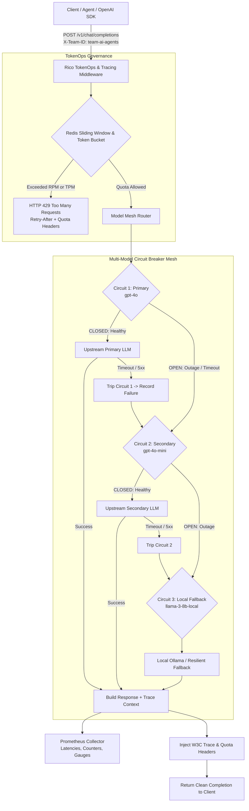

# Rico — Zero-Downtime Multi-Model LLM Gateway & TokenOps Proxy

[](https://www.python.org/)
[](https://fastapi.tiangolo.com/)
[](https://redis.io/)
[](https://prometheus.io/)
[](https://www.docker.com/)
[](https://render.com/)

An enterprise-grade, high-concurrency Python FastAPI proxy gateway engineered for **zero-downtime, multi-model agent architectures**. 

Rico provides automated **circuit-breaker failover**, **Redis-backed sliding-window rate limiters**, **token-bucket TokenOps quota enforcement**, and **Prometheus metrics with W3C distributed tracing**.

---

## Architecture Overview



---

## What the System Does

1. **Zero-Downtime Multi-Model Circuit Breakers**:
   - Monitored upstream model hierarchy: **Tier 1 Primary** (`gpt-4o`) &rarr; **Tier 2 Secondary** (`gpt-4o-mini`) &rarr; **Tier 3 Local Fallback** (`llama-3-8b-local`).
   - If an upstream model experiences consecutive timeouts or 5xx errors exceeding threshold (default: 3), its circuit trips to `OPEN`.
   - Inbound requests automatically bypass failing models with **zero delay**, falling over instantly to backup models.
   - After `recovery_time_sec` (default: 20s), the breaker switches to `HALF_OPEN`, dispatching a single canary probe to verify model health before restoring full traffic.

2. **Redis-Backed Sliding Window & Token Bucket Quotas**:
   - **Sliding-Window Log / Counter (RPM)**: Enforces exact per-minute request limits per engineering team using Redis sorted sets (or in-memory sliding window when offline).
   - **Continuous Token-Bucket (TPM)**: Enforces strict token-per-minute budgets per team. Refills tokens continuously and deducts prompt + completion tokens.
   - Per-team isolation prevents noisy-neighbor outages (e.g. `team-growth` exhausting capacity cannot impact `team-ai-agents`).

3. **Prometheus Telemetry & W3C Distributed Tracing**:
   - Native `/metrics` endpoint exporting:
     - `rico_requests_total{team, model, status, fallback}`
     - `rico_request_duration_seconds` (latency histograms with standard percentile buckets)
     - `rico_tokens_consumed_total{team, model, type}`
     - `rico_circuit_state{model}` (0=CLOSED, 1=HALF_OPEN, 2=OPEN)
     - `rico_circuit_trips_total{model}`
   - W3C Distributed Tracing support via `traceparent` headers with automatic span propagation.

4. **Mission Control UI & Interactive Playground**:
   - Dark glassmorphism dashboard served at `http://localhost:8000/` with live circuit breakers, chaos simulation buttons, chat console, and TokenOps meters.

---

## 🎨 Mission Control UI Cockpit

Navigating to `http://localhost:8000/` opens the developer dashboard:

- **Circuit Breaker Mesh**: Visual state cards for `gpt-4o`, `gpt-4o-mini`, and `llama-3-8b-local` with real-time status lights (`CLOSED`, `OPEN`, `HALF_OPEN`) and interactive **"Simulate Outage"** / **"Recover Model"** chaos testing buttons.
- **Chat Completions Console**: Test prompts with custom team identities, view the exact model that fulfilled the request, and inspect failover chains with live latency stopwatches.
- **Team TokenOps & Quota Explorer**: Live RPM utilization and token-bucket capacity meters for engineering teams.
- **Prometheus Metrics Explorer**: Live stream of the `/metrics` endpoint.

---

## OpenAI SDK Drop-in Replacement

Because Rico exposes an OpenAI-compatible API, you can point your existing OpenAI SDK client directly to Rico:

```python
from openai import OpenAI

# Point your OpenAI client to Rico's proxy URL
client = OpenAI(
    base_url="http://localhost:8000/v1",
    api_key="rico-dev-token",
    default_headers={"X-Team-ID": "team-ai-agents"}
)

response = client.chat.completions.create(
    model="gpt-4o",
    messages=[{"role": "user", "content": "Generate system architecture diagram."}]
)

# Even during an OpenAI outage, Rico transparently serves completion via fallback models!
print(response.choices[0].message.content)
```

---

## Direct Python Library Usage

```python
from rico import ModelMeshRouter, ChatCompletionRequest, ChatMessage

router = ModelMeshRouter()

# Execute chat through circuit breaker mesh
response = await router.execute_chat(
    ChatCompletionRequest(
        messages=[ChatMessage(role="user", content="Hello world")],
        team_id="team-analytics"
    )
)

print(f"Model used: {response.model}")
print(f"Fallback active: {response.fallback_trace.fallback_triggered}")
print(f"Latency: {response.fallback_trace.total_latency_ms}ms")
```

---

## REST API Reference

| Method | Endpoint | Description |
| :--- | :--- | :--- |
| `POST` | `/v1/chat/completions` | OpenAI-compatible resilient chat proxy |
| `GET` | `/metrics` | Prometheus text exposition metrics |
| `GET` | `/v1/circuits` | Lists all model circuit breaker states |
| `POST` | `/v1/circuits/{model_id}/trip` | Forces a model circuit to OPEN (chaos test) |
| `POST` | `/v1/circuits/{model_id}/reset` | Recovers a model circuit to CLOSED |
| `GET` | `/v1/quotas/teams` | Lists all team TokenOps quota utilizations |
| `GET` | `/v1/quotas/teams/{team_id}` | Gets quota details for a specific team |
| `PUT` | `/v1/quotas/teams/{team_id}` | Updates RPM / TPM limits for a team |
| `GET` | `/health` | Liveness health probe |
| `GET` | `/ready` | Readiness health probe |

---

## Docker Compose Stack

Rico includes a complete `docker-compose.yml` deploying **Rico Gateway + Redis + Prometheus**:

```bash
# Start complete stack
docker compose up --build
```

- **Rico Gateway & Mission Control**: `http://localhost:8000/`
- **Prometheus Dashboard**: `http://localhost:9090/`
- **Redis Instance**: `localhost:6379`

---

## Running Integration Tests

```bash
# 1. Install dependencies
pip install -r requirements.txt -r requirements-dev.txt

# 2. Run complete test suite with coverage
pytest
```

---

## 🚀 How to Deploy on Render

Rico is packaged as a minimal, non-root Python 3.11+ container. You can deploy it to [Render](https://render.com) using the included Blueprint or manual web service.

### Option 1: 1-Click Render Blueprint (`render.yaml`)

Rico includes a root `render.yaml` blueprint defining the Gateway Web Service and a managed Redis instance:

1. Push your repository to GitHub or GitLab.
2. Open the [Render Dashboard](https://dashboard.render.com/) and go to **Blueprints > New Blueprint Instance**.
3. Connect the repository containing Rico.
4. Render automatically configures:
   - Web Service: `rico-gateway-service` (Docker runtime, port `8000`, `/health` probe)
   - Redis Instance: `rico-redis` connected via private networking (`REDIS_URL`)
5. Click **Apply**. Once provisioned, open your live URL (e.g. `https://rico-gateway-service.onrender.com/`) to access Mission Control.

### Option 2: Manual Setup via Render Dashboard

1. In Render Dashboard, click **New + > Web Service**.
2. Select your repository.
3. Set **Environment** to `Docker`.
4. In **Advanced > Health Check Path**, enter: `/health`.
5. Configure Environment Variables:
   | Variable | Value | Description |
   |---|---|---|
   | `RICO_ENV` | `production` | Production environment |
   | `PORT` | `8000` | Port listened by Uvicorn |
   | `HOST` | `0.0.0.0` | Bind address |
   | `REDIS_URL` | `redis://...` | Internal Redis connection string |
   | `OPENAI_API_KEY` | `sk-...` | Upstream OpenAI provider key |
   | `RICO_API_TOKENS` | `your-secret-token` | Comma-delimited allowlist of Bearer tokens |
6. Click **Create Web Service**. Render builds the multi-stage image, passes health checks, and goes live with automated TLS.
